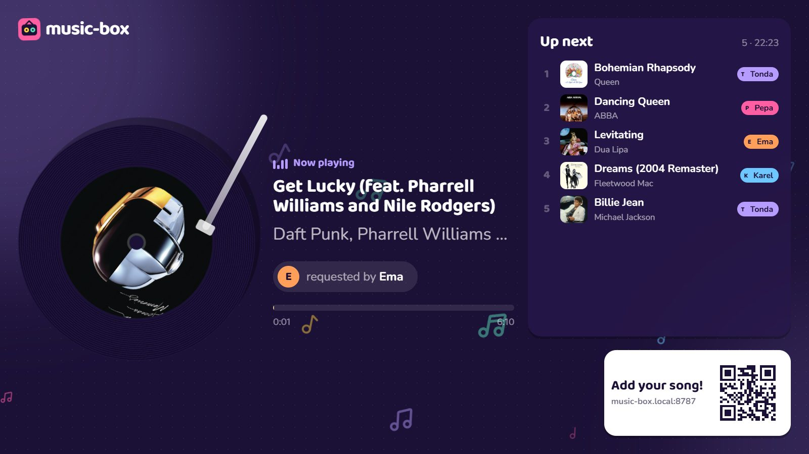
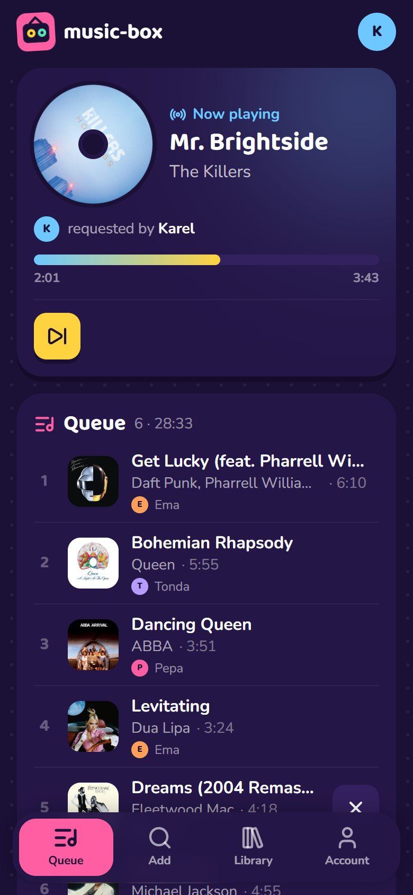
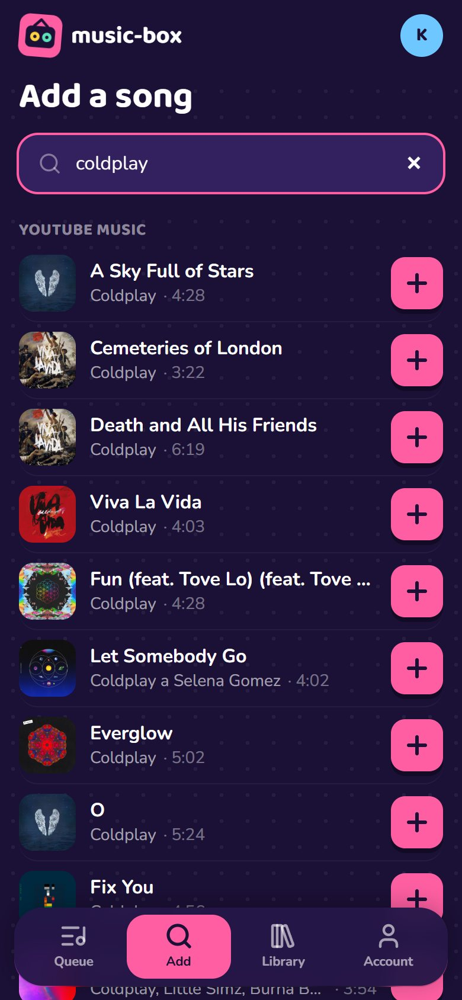
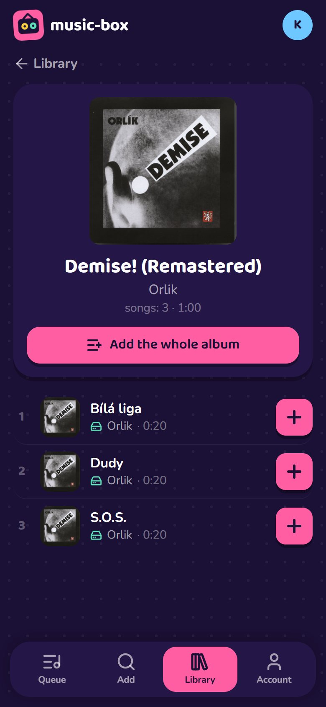
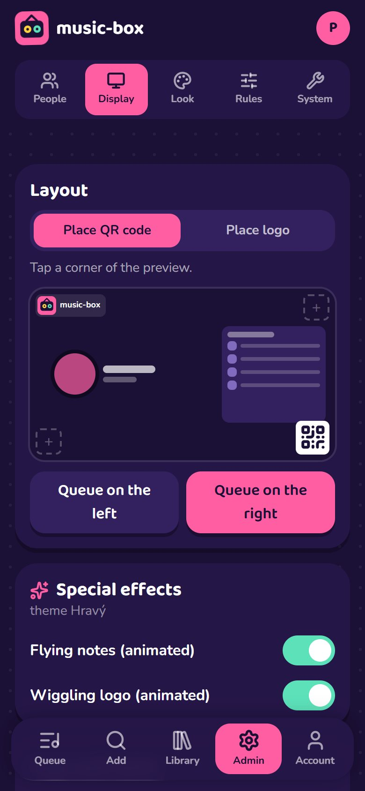
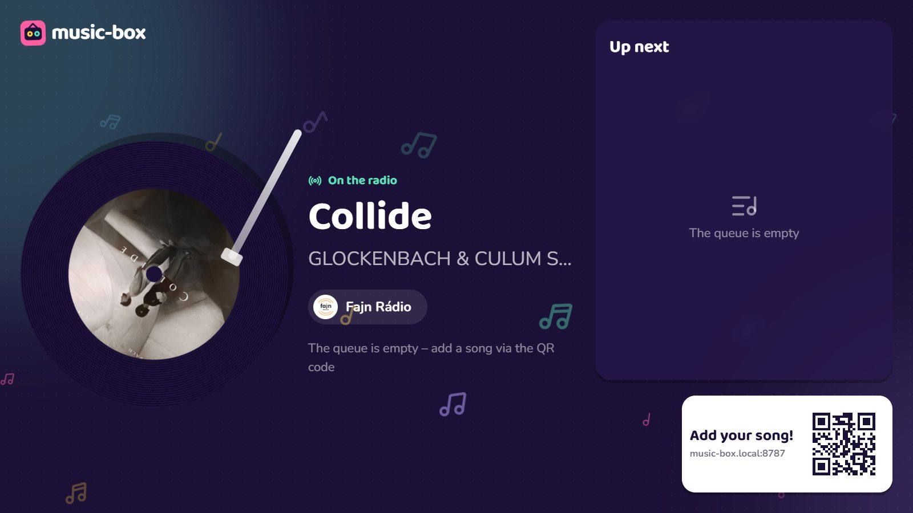
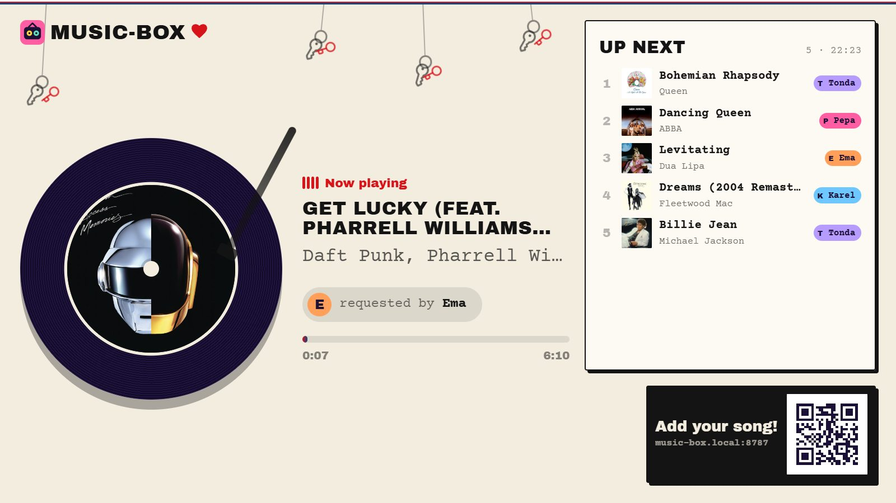
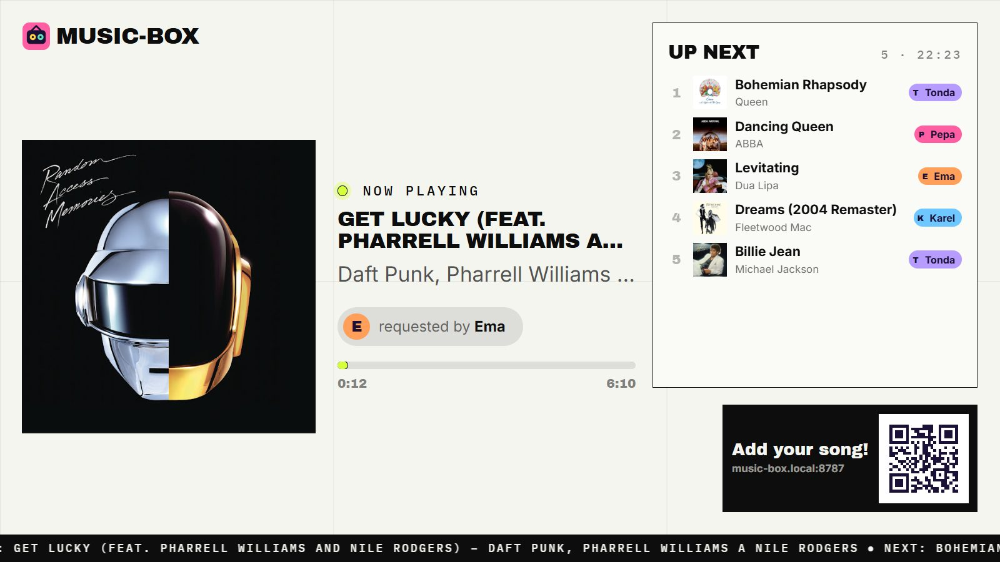

# music-box

A party jukebox. A computer with speakers and a screen shows **what is playing, what is in the queue
and who added it**. Guests scan the QR code on the screen and see the queue right away – no account
needed. People who want to add songs sign up, and an admin turns them into DJs.

- **Display app** (fullscreen) – now playing, up next, who requested it, QR code, theme effects.
- **Mobile web** – public queue, search and add songs, browse the local library, admin panel.
- **Sources** – YouTube / YouTube Music, Spotify links, your own music files, internet radio.
- **Runs on** Windows and Linux (with or without a screen).



| Queue | Add a song | Library | Admin – display layout |
|:---:|:---:|:---:|:---:|
|  |  |  |  |

More: [themes](#themes) · [radio](#radio) · [theme picker](docs/screenshots/web-admin-themes.jpg)

## Install

The easiest way is a ready-made installer from **[Releases](https://github.com/ItsCr4zyyy/music-box/releases)** –
nothing else needs to be installed.

- **Windows:** [docs/install-windows.md](docs/install-windows.md)
- **Linux** (Debian, Ubuntu, Raspberry Pi OS, headless servers): [docs/install-linux.md](docs/install-linux.md)

Building from source needs **Node.js and Rust** – Node.js alone is not enough, the core is written in Rust.

First run: scan the QR code on the screen and **sign up – the first account becomes the administrator**.

## Roles

| Role | Can |
|---|---|
| *(no account)* | see what is playing and the queue |
| **Guest** | the same, but has an account (e.g. a DJ whose rights were taken away) |
| **DJ** | search and add songs and albums, remove / skip their own songs |
| **Administrator** | everything: pause / skip / volume, queue priority and order, approving people, roles, blocking, settings |

New people sign up themselves and wait for approval in **Admin → People**.

**What DJs can add** – **Admin → Rules**: allow or block YouTube Music search, YouTube / Spotify
links and the local library separately (e.g. only music from the disk). Admins can always add everything.

## Music sources

- **YouTube / YouTube Music** – fast search through YouTube Music, audio is downloaded with
  [yt-dlp](https://github.com/yt-dlp/yt-dlp) and the next songs in the queue are fetched in advance.
  yt-dlp downloads itself on first start and can be updated in **Admin → System**.
- **Spotify** – paste a song link (DJs) or an album / playlist link (admins). Spotify audio can't be
  downloaded (DRM), so each song is matched on YouTube Music by title, artist and length.
- **Your own files** – MP3, FLAC, M4A/AAC, OGG Vorbis, WAV (not Opus).
- **Internet radio** – plays when the queue is empty (see below).

### Your own music

The `music` folder is created next to the app on first start (when that location is not writable,
e.g. a system-wide install, `Music/music-box` in your home folder is used instead). The exact path is
shown in **Admin → System**.

```
music/
├── Artist - Album/            ← a subfolder = an album (cover: cover.jpg / folder.jpg or embedded)
│   ├── 01 - ….mp3
│   └── 02 - ….mp3
├── Artist - Song.mp3          ← files directly in the folder = singles
└── …
```

After copying files: **Admin → System → Rescan folders**. Track order comes from the tags, or from the
number at the start of the file name. More folders (USB drive…) can be added in **Admin → Rules**.

**Identify** (like Jellyfin): in the **Library**, an admin can identify an album or a song using
**Deezer** and **MusicBrainz** and pick the match. The cover, album title, artist and optionally the
track titles are filled in. Manually identified data survives rescans and can be reset to the file tags.

## Radio

**Admin → Rules → When the queue is empty → Play the radio.** As soon as someone adds a song the radio
stops, and it comes back after the queue is finished. Stations are found in the open
[radio-browser.info](https://www.radio-browser.info) directory or added manually. They must stream MP3 or
AAC over **Icecast / SHOUTcast** – the artist and title of the current song are read from the stream
and the cover is looked up on Deezer.



## The display

Everything is set from the web in **Admin → Display** and applied immediately: the corner and size of
the QR code and of the logo with the name, your own logo, the text next to the QR code, the side and
length of the queue, who-added-it, fullscreen, language and the special effects of the current theme.
F11 on the display toggles fullscreen temporarily.

**Audio output** – **Admin → System**: tick one or more output devices (Windows WASAPI, Linux ALSA
including PipeWire / PulseAudio). With several devices the music plays on all of them at once – great
for different rooms; in the same room a small delay between them may be audible, because every sound
card has its own clock. Changes apply right away and the song continues where it was.

**Even out the volume** – **Admin → System** (on by default): every song is measured once (gated
loudness, similar to EBU R128 / ReplayGain) and played louder or quieter with a limiter, so a quiet old
recording and a loud modern master end up at a similar level. The radio is left as it is.

## Themes

**Admin → Look** – a theme applies to both the web and the display. Built-in themes:

### Hravý (Playful) – default

Purple night, candy colours, round shapes.
Effects: flying notes (animated), wiggling logo (animated).
**Download:** [`hravy.json`](core/assets/themes/hravy.json)


### Devadesátky (Nineties)

Freedom after 1989: paper, poster headings, typewriter, square cards, no UI animations.
Effects: jingling keys (animated), tricolour on top (static), heart after the name (static).
**Download:** [`devadesatky.json`](core/assets/themes/devadesatky.json)



### Ostrý (Sharp)

Clean and simple: off-white, thin black lines, lime, heavy headings, typewriter labels, a square cover
instead of the record.
Effects: pulsing dot (animated), ticker at the bottom (animated), grid lines (static).
**Download:** [`ostry.json`](core/assets/themes/ostry.json)



Each effect of the current theme can be switched on and off in **Admin → Display → Special effects**.

The `.json` files above are complete themes – open one and use **Download raw file** on GitHub, edit it
and upload it in **Admin → Look → Upload theme**. (Built-in themes are already included in the app;
uploading an edited copy adds it as a new theme.)

**Your own theme:** download any theme as a template, edit `theme.json` and upload it back. For your own
fonts upload a ZIP (`theme.json` + `.woff2` / `.ttf` files). A theme with the same name is replaced.

```json
{
  "name": "My theme",
  "description": "…",
  "colors": { "background": "#…", "surface": "#…", "surface_2": "#…", "surface_3": "#…", "text": "#…",
              "primary": "#…", "secondary": "#…", "success": "#…", "info": "#…", "extra": "#…",
              "on_accent": "#…" },
  "fonts": { "heading": "My font", "body": "Inter Variable" },
  "font_files": [{ "family": "My font", "file": "my.woff2", "weight": "400" }],
  "radius": 1.0,
  "shadow": "chunky | soft | hard | none",
  "pattern": "dots | grid | lines | none",
  "animations": true,
  "css": "/* extra CSS: .card .btn .input .chip .mb-brand .mb-label .mb-panel .mb-progress .mb-glow .mb-accent-scope .mb-vinyl-* .mb-disc */",
  "effects": [
    { "id": "notes", "name": "Flying notes", "animated": true, "default": true, "css": "" },
    { "id": "my-effect", "name": "My effect", "animated": false, "default": true, "css": ".mb-brand { text-decoration: underline; }" }
  ]
}
```

`on_accent` is the text colour on coloured buttons. Built-in effects drawn by the display: `notes`,
`keys`, `ticker`; any other ID is pure CSS from its `css` field (used only while the effect is on).
Built-in fonts: Baloo 2 Variable, Nunito Variable, Archivo Black, Courier Prime, Inter Variable,
IBM Plex Mono.

## Languages

Czech and English. **Admin → Display → Language** sets the display language and the default web
language; everyone can pick their own in **Account**. Adding a language = a new file
`web/src/lib/locales/<code>.ts` with the same keys as `cs.ts`, plus the display texts in
`box/src/lib/i18n.ts`.

## Project structure

```
core/   Rust – database (SQLite), player (rodio), YouTube / Spotify / local / radio sources, HTTP + WebSocket API
box/    Tauri + Svelte + Tailwind – the display app; runs core inside
web/    SvelteKit + TypeScript + Tailwind – mobile web (served by core)
docs/   installation guides
```

## Development

```bash
cd web && npm install && npm run build && cd ..   # the web (served by the app)
cd box && npm install && npm run tauri dev        # display + server
```

The web is then at `http://<computer-ip>:8787/`. For live-reload of the web: `cd web && npm run dev`
(proxies the API to port 8787). Without a display: `cargo run --bin musicbox-headless`.

| Variable | Meaning | Default |
|---|---|---|
| `MUSICBOX_PORT` | web / API port | `8787` |
| `MUSICBOX_DATA` | database, downloaded songs, yt-dlp | `%APPDATA%\music-box` / `~/.local/share/music-box` |
| `MUSICBOX_MUSIC` | main music folder | `music/` next to the app |
| `MUSICBOX_WEB` | built web folder | `web/build` (automatic) |
| `MUSICBOX_YTDLP` / `MUSICBOX_FFMPEG` | custom program paths | PATH |

**Release:** `git tag v0.1.0 && git push origin v0.1.0` – GitHub Actions builds the Windows installers
(`-setup.exe`, `.msi`) and Linux packages (`.deb`, `.AppImage`) and publishes them in Releases.

## Notes

- Downloading from YouTube is against its terms of service – the project is meant for private use.
- The display reads the queue without logging in; everything else needs an account.

## License

[GNU General Public License v3.0 or later](LICENSE). You may use, study, change and share music-box
freely; if you distribute a modified version, it has to stay under the GPL with its source code available.
